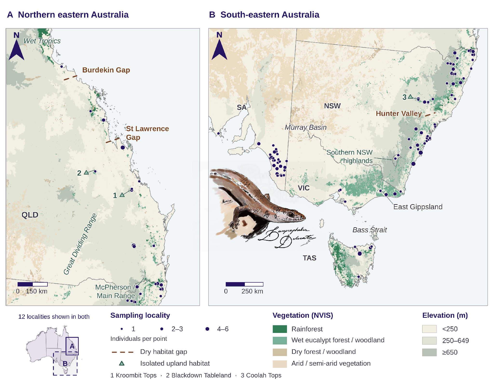
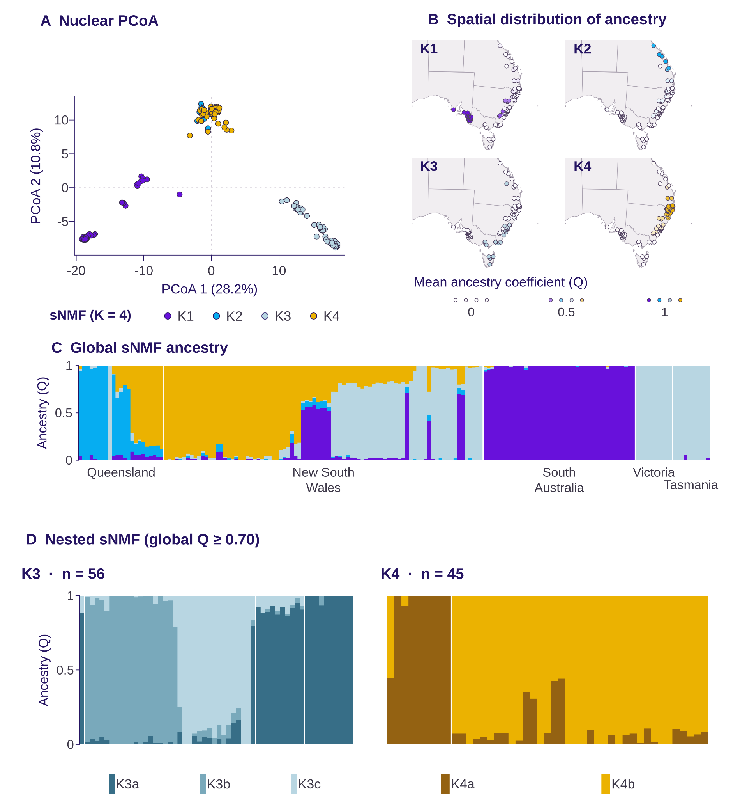
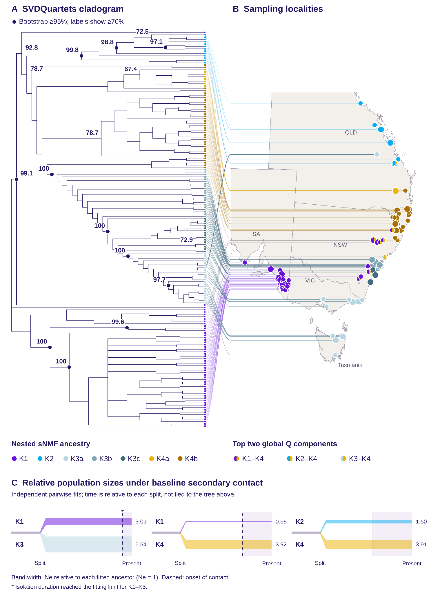
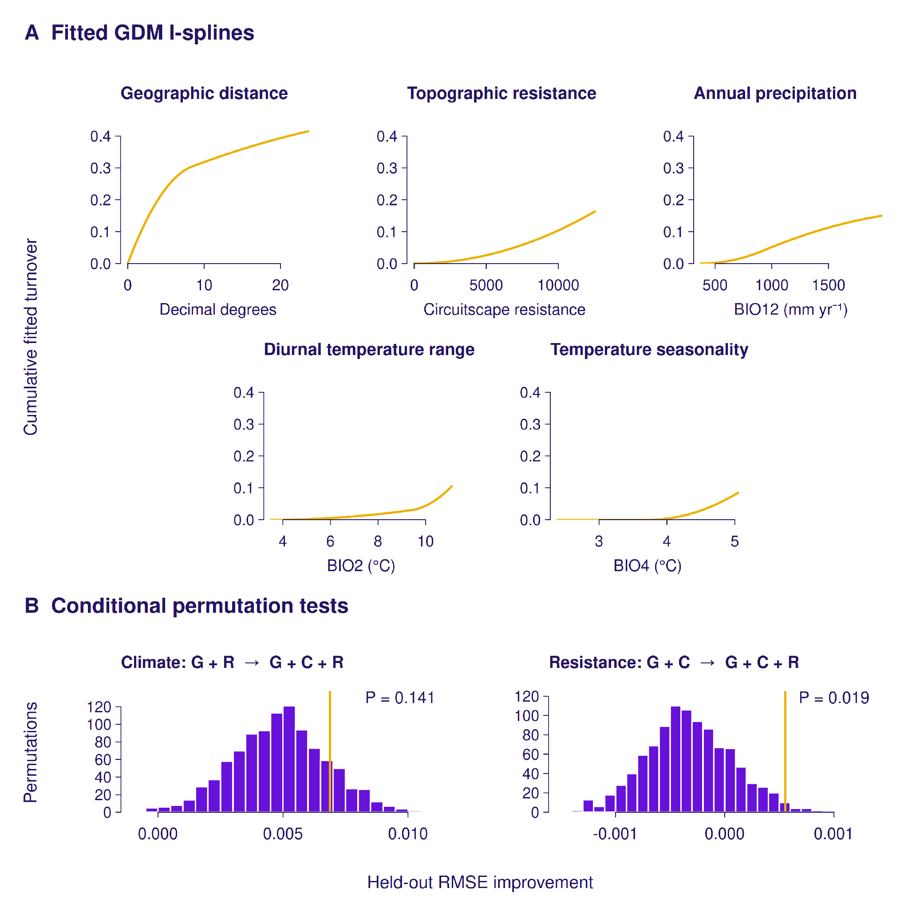
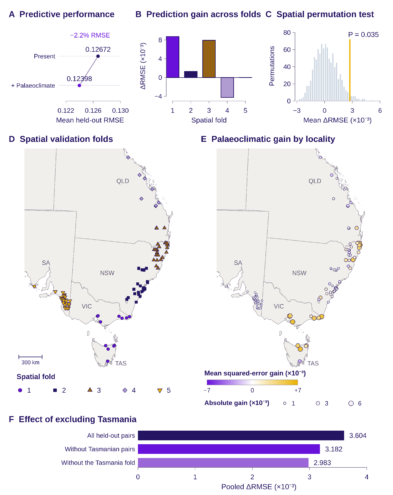
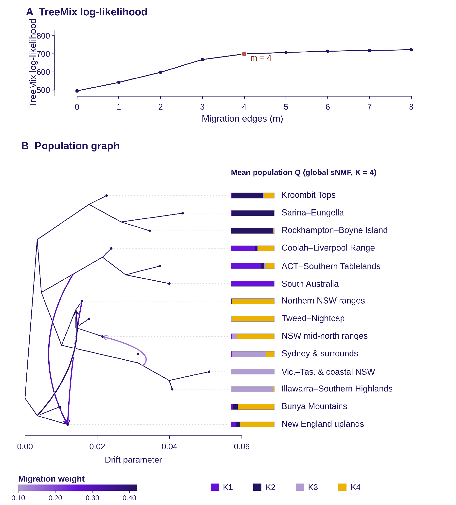
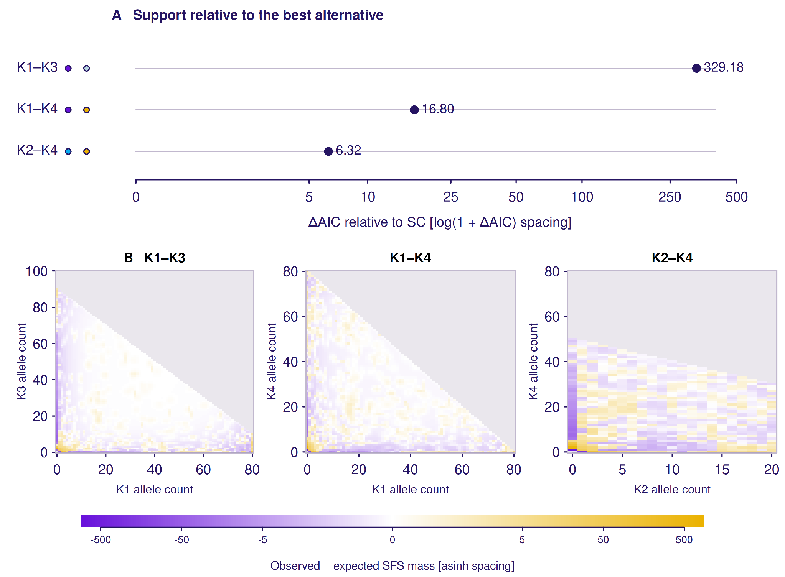

# Signatures of past climates: genomic history of *Lampropholis delicata*


**Repository status.** This repository will be updated as the associated publications progress.

## Why study a widespread skink?

I wanted to know why nuclear genomes differ among populations of a skink sampled from Queensland to Tasmania and west into South Australia. Are geographically separated populations simply farther apart, or do present terrain and historical climates help explain where genomic differences accumulate? We used population genomics, geographic sampling and models of landscape and population history to ask those questions at different scales.


The order of this page follows the questions I asked, not simply the names of the software. At each step I explain what the analysis was meant to distinguish, where its inputs and code are found, and what the result can—and cannot—tell us. If you are adapting the approach to another species, pay particular attention to how populations, spatial folds and alternative models are defined. Those decisions matter more than copying an R command unchanged.

**How to use this repository.** The figures and aggregate results can be inspected here. Some analyses require genotype matrices, locality records, climate layers and other source inputs described in the documentation. The [reproduction guide](docs/reproducibility.md) distinguishes what can be drawn from the available summaries from what requires the original analytical inputs. A link to a script is not a promise that it runs on a fresh checkout. For methods, consult the [methods notes](docs/methods.md), [input descriptions](data/provenance.md) and [figure sources](docs/figures.md).

## From geographic sampling to nuclear variation

Across 101 localities, the reference-aligned panel contains **170 individuals and 19,352 ddRAD SNPs**. Landscape models use a **19,131-SNP background panel** after removing 221 candidates from a recoverable climate-association analysis. This does not make the remaining markers demonstrably neutral. See [Figure 1](results/figures/Figure_1_geographic_context.pdf), the [map source](analysis/01_genomic_filtering/Fig1_Geographic_context_v3.R) and the [input notes](data/provenance.md).


The first check is whether the genomic data, collection records and sampling map refer to the same individuals. This seems elementary, but a sample-name mismatch can change every geographic comparison that follows. For another study, document the count before and after each filter and keep a stable identifier through genotype matrices, environmental tables and plots.



*Figure 1.* Sampling geography and environmental context. [PDF](results/figures/Figure_1_geographic_context.pdf) · [Map source](analysis/01_genomic_filtering/Fig1_Geographic_context_v3.R).

## What the mitochondrial lineages led us to expect

Chapple et al. (2011) described nine geographically structured mitochondrial clades in eastern Australia. Some divisions coincide with dry habitat gaps or isolated uplands. That made those features useful for interpreting a nuclear comparison, but not for assigning individuals to nuclear groups in advance. The two data sources also differ in inheritance and need not tell identical histories.

## Four broad clusters, with regional detail

We retained **K = 4** at the elbow of the sNMF curve to summarize broad structure, although cross-entropy was numerically lowest at **K = 9**. Nested analyses further resolved K3 and K4. PCoA and sNMF describe structure at complementary scales; the clusters are not species assignments. See [Figure 2](results/figures/Figure_2_nuclear_structure.pdf), its [renderer](analysis/02_population_structure/Fig2_Nuclear_structure.R), and the [nested sNMF source](analysis/02_population_structure/hierarchical_snmf.R).


Why use both ordination and ancestry models? PCoA shows the main directions of genomic variation without assigning individuals to categories. sNMF provides a different summary that helps locate mixtures and nested geographic patterns. I chose K = 4 to describe the broad structure, not because four is the only biologically meaningful partition. On another dataset, inspect the cross-entropy curve, replicate stability and spatial coherence before choosing a level to present.



*Figure 2.* Broad nuclear structure and regional subdivisions. [PDF](results/figures/Figure_2_nuclear_structure.pdf) · [Renderer](analysis/02_population_structure/Fig2_Nuclear_structure.R) · [K comparison](results/summary_tables/structure/snmf_cross_entropy.csv).
## Nuclear relationships across eastern Australia

SVDQuartets used 14,766 sites and 170 individuals, with 100,000 randomly sampled quartets and 1,000 bootstrap replicates. We added geographic and ancestry labels after inferring the [unrooted tree](results/figures/Figure_3_svdquartets.pdf). Support values are neither branch lengths nor ages. See the [PAUP block](analysis/03_phylogenetics/run_svdquartets_ref5_random_final.paup) and [tree–map renderer](analysis/03_phylogenetics/Fig3_SVDQuartets_geography_v4.R).


This tree answers a different question from sNMF: it summarizes relationships among sampled nuclear genotypes under a quartet-based method. I inferred it without using the ancestry colors; those colors were added afterwards to compare the summaries. The tree is unrooted, so its branching pattern should not be read as a timeline or an ancestral dispersal route.



*Figure 3.* Nuclear relationships mapped back to the sampling geography. [PDF](results/figures/Figure_3_svdquartets.pdf) · [Tree–map renderer](analysis/03_phylogenetics/Fig3_SVDQuartets_geography_v4.R) · [Run summary](results/summary_tables/phylogeny/svdquartets_final_run_summary.csv).
## How much does geography explain?

Geographic distance contributed most in the contemporary GDM. Current climate reduced spatially held-out mean RMSE by 0.006880, but its conditional null did not support that gain (P = 0.141). Topographic resistance supplied a smaller gain (0.000553), supported under its own conditional null (P = 0.019). These are distinct tests, not independent shares of explained variation. See [Figure 4](results/figures/Figure_4_contemporary_gdm.pdf), its [renderer](analysis/05_contemporary_GDM/Contemporary_GDM_revised.R) and [analysis source](analysis/05_contemporary_GDM/gdm_definitive_spatial_pipeline.R).


Populations close together often share both climates and allele frequencies. We compared geography alone (G), geography plus climate (GC), geography plus resistance (GR), and all three components (GRC). The incremental climate comparison is GRC versus GR; the resistance comparison is GRC versus GC. For each of five folds, whole localities were held out, climate screening and model fitting used only the other four folds, and test pairs had both endpoints in the withheld fold.

The [analysis code](analysis/05_contemporary_GDM/gdm_definitive_spatial_pipeline.R) uses the following locality-to-fold assignment. Here `xy_m` contains geographic coordinates converted with a local equirectangular approximation, `loc_key` identifies unique coordinate pairs and `nfold` is five:

```r
u <- !duplicated(loc_key); km <- kmeans(scale(xy_m[u,,drop=FALSE]),centers=nfold,nstart=100)
fold_map <- setNames(km$cluster,loc_key[u]); env$fold <- unname(fold_map[loc_key])
```

Each conditional test used 999 spatial permutations of the relevant training information while keeping the test data unchanged. The climate gain was positive but not unusual under its null; the smaller resistance gain was unusual under a different null. A lower held-out RMSE and evidence against a spatial null answer different questions.



*Figure 4.* Contemporary predictor curves and conditional comparisons. [PDF](results/figures/Figure_4_contemporary_gdm.pdf) · [Renderer](analysis/05_contemporary_GDM/Contemporary_GDM_revised.R) · [Conditional nulls](results/summary_tables/gdm/spatial_group_null_summary.csv).
## Historical landscapes still leave a signal

Adding mean transformed glacial and interglacial climate distance (PaleoMean) to the contemporary model reduced mean held-out RMSE from **0.12672 to 0.12398** (ΔRMSE = **0.002739**, about **2.16%**; conditional spatial **P = 0.035**). This is a mean across five folds, not a pooled mean over all pairs. Three folds improved; one was effectively unchanged and one had higher error. The periods did not show significant conditional support when tested separately. Excluding comparisons involving Tasmania is a sensitivity check, not the primary result.


The Last Interglacial and Last Glacial Maximum represent contrasting combinations of temperature, precipitation, vegetation and sea level. Exposure of the Bassian land bridge provided a land connection, but a land connection need not provide continuous mesic habitat. We applied the contemporary climate transformations to the two reconstructed climates and asked whether historical distances added predictive information on the same spatial folds. These periods are predictors, not dates assigned to nuclear splits.



*Figure 5.* The size and spatial distribution of the historical improvement. [PDF](results/figures/Figure_5_palaeoclimate.pdf) · [Renderer](analysis/06_palaeoclimate/Figure5_palaeoclimate_final.R) · [Fold results](results/summary_tables/palaeoclimate/historical_model_comparison.csv) · [Conditional comparison](results/summary_tables/palaeoclimate/corrected_historical_null_summary.csv).

## Population relationships in TreeMix

TreeMix used **14 geographic groups, 163 individuals and 15,955 loci**. We compared ten runs at each m from 0 to 8 and show m = 4 as a descriptive compromise, not evidence for exactly four historical migrations. See [Figure 6](results/figures/Figure_6_treemix.pdf), its [renderer](analysis/07_TreeMix/TreeMix_revised.R) and [replicate results](results/summary_tables/treemix/likelihood_all_runs.csv).

TreeMix describes how much allele-frequency covariance is left unexplained by a branching population graph. Its arrows are fitted relationships, not observed journeys or dated migration events. I compared multiple runs over different numbers of edges and show one graph to make the major relationships visible. This provides context for admixture, but it does not by itself distinguish continuous migration from renewed contact after isolation.



*Figure 6.* Population graph and model fit across edge counts. [PDF](results/figures/Figure_6_treemix.pdf) · [Renderer](analysis/07_TreeMix/TreeMix_revised.R) · [Fit summaries](results/summary_tables/treemix/likelihood_all_runs.csv).

## Comparing demographic histories

We compared strict isolation (SI), isolation with continuous migration (IM), ancient migration (AM) and secondary contact (SC) using folded joint site-frequency spectra (SFS). Folding avoids assigning an ancestral state; projection puts allele counts on a common sample-size basis within each contrast. Among these four models, SC had the smallest AIC, with ΔAIC for IM relative to SC of **329.18, 16.80 and 6.32** for K1–K3, K1–K4 and K2–K4 respectively. That ranking does not test equally flexible size histories or date contact.

The [Figure 7 renderer](analysis/08_demography/plot_figure7_archived.R) reads the saved observed-minus-expected residuals. It masks excluded bins, including the origin, and uses `asinh(x / .25)` to allocate colours; the colour-bar ticks retain the original SFS mass units. Residuals show where the preferred fit misses the observed spectrum, not independent tests of each cell. Expanded size models and the incomplete four-population fit are separate from this comparison.



*Figure 7.* Baseline demographic comparisons and signed SFS residuals. [PDF](results/figures/Figure_7_baseline_demography.pdf) · [Renderer](analysis/08_demography/plot_figure7_archived.R) · [Model and SFS table](results/summary_tables/moments/Figure7_A_model_and_SFS_cells.csv).

## Diversity among geographic populations

The [diversity table](results/summary_tables/population_genetics/TableS_Lampropholis_population_genetic_diversity.csv) and [pairwise matrix](results/summary_tables/population_genetics/TableS_Lampropholis_pairwise_FST_matrix.csv) use **5,827 shared eligible SNPs** from the 14 TreeMix groups. Bunya Mountains (`colossus`) is a sampling label, not a taxonomic assignment. The estimates are conditional on the assayed SNPs, not per-base diversity. The [diversity code](analysis/09_population_diversity/population_genetics.R) keeps geographic and Q-defined groups separate.

## Adapting the study to another species

Start with the sample IDs and local climate layers, not the cluster colours or the number of clusters. The [GDM source](analysis/05_contemporary_GDM/gdm_definitive_spatial_pipeline.R) aligns genotypes, sample records and the resistance matrix before calculating pairwise distances. Use geographic folds that keep whole localities together and compare models on the same withheld pairs. Select climate predictors from training data, preserving units when moving between climate products. The [historical model source](analysis/06_palaeoclimate/gdm_stage6_historical_landscape.R) shows why applying a contemporary transformation to the past is different from estimating a new one.

Keep sampling geography, nuclear ancestry and the population definitions used for allele-count graphs distinct. The [diversity code](analysis/09_population_diversity/population_genetics.R) gives one example of how to document that distinction. For demographic questions preserve the projection, the SFS mask, the fitted spectra and the model parameterisation; read residuals alongside AIC and require agreement across the relevant summaries. RAD SNPs describe an ascertained subset of the genome; the resulting diversity estimates are not per-base estimates for an entire genome.

The [figure index](docs/figures.md), [methods](docs/methods.md) and [reproduction guide](docs/reproducibility.md) identify inputs and show which steps can be rerun. The [four-population moments checks](docs/moments_4d_status.md) remain separate from the article's pairwise comparisons.

The [supplementary figure gallery](docs/r7_supplementary_figures.md) brings together the seven additional plates included in the R7 thesis.

## Data availability and citation

See [data availability](docs/data_availability.md) for inputs not distributed here. The original project credits Dr Sally Potter for her contribution to the analysis. Credits, artwork and reuse terms remain subject to approval; see the [reuse and credit notes](LICENSE-STATUS.md).

