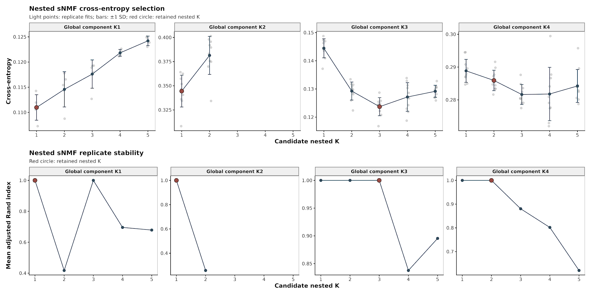
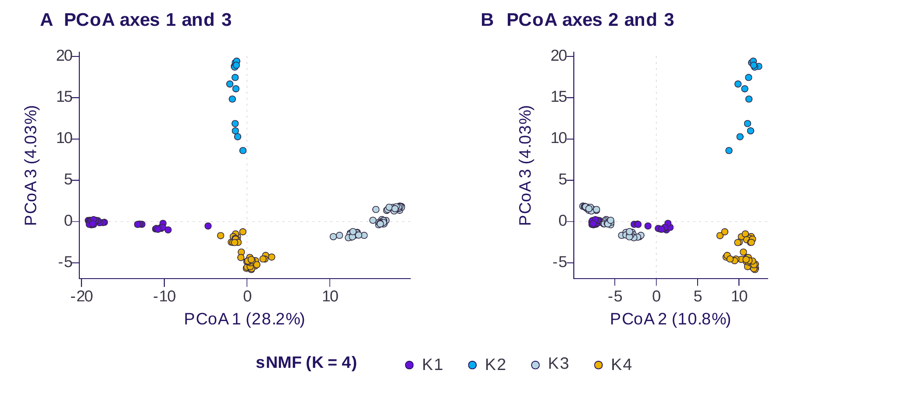
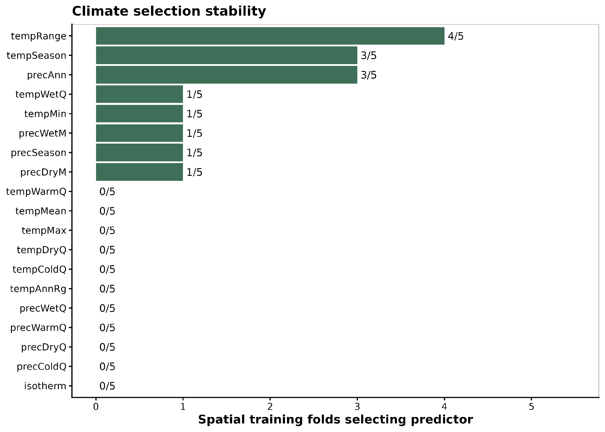
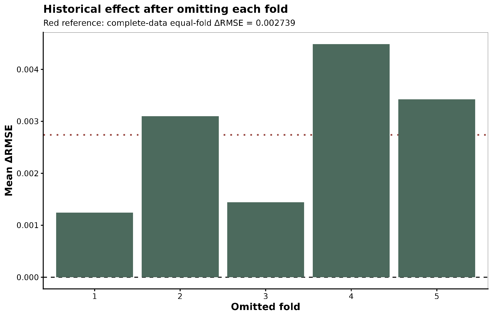
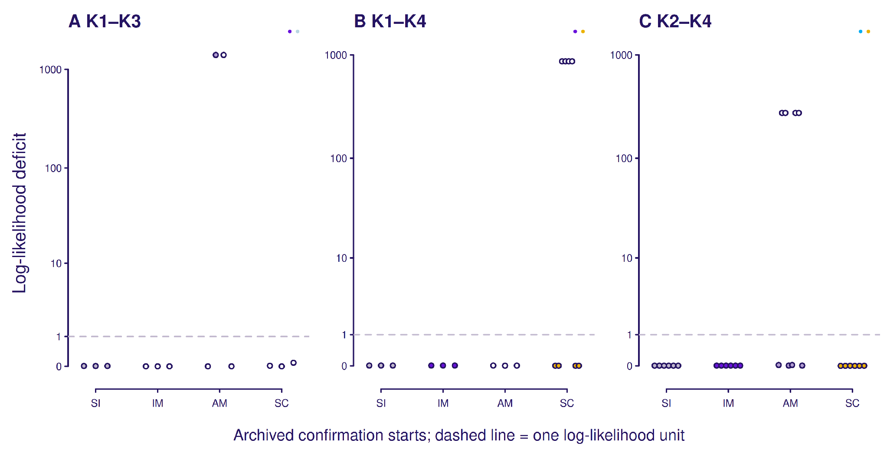
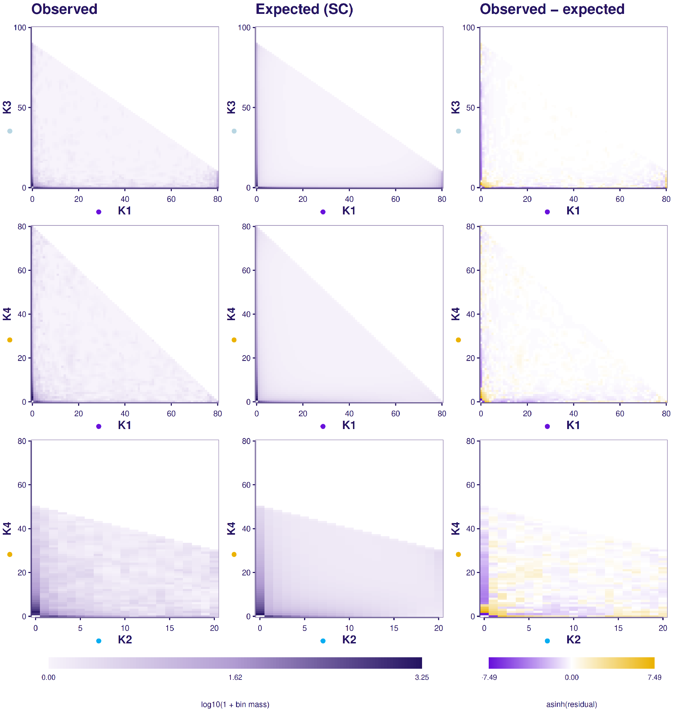
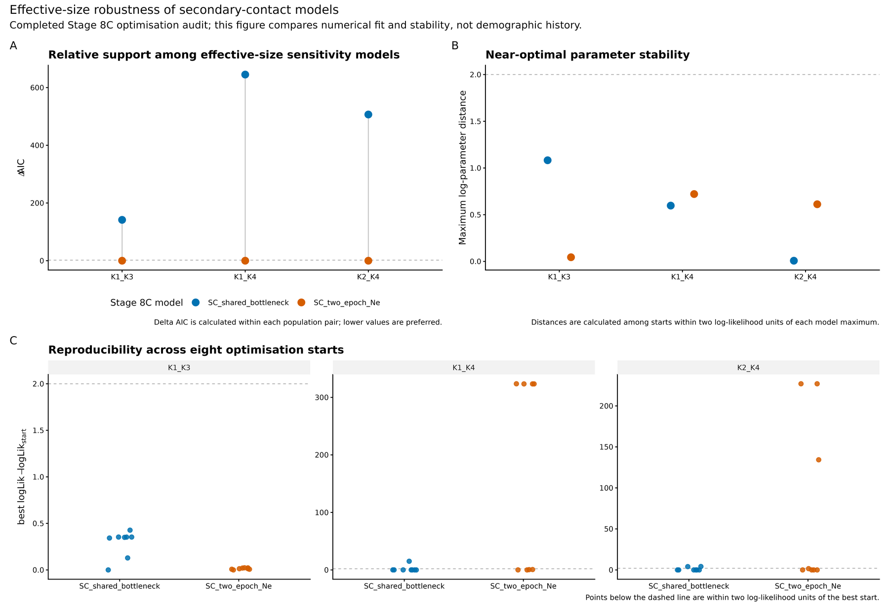

# Supplementary figures from the R7 thesis

These plates follow the numbering used in Chapter 2 of the thesis. The PNG files are extracted from the thesis document; PDF viewing copies were made from these images. The original vector plotting exports can be added as the associated publications progress.

## Supplementary Figure S1. Nested sNMF cross-entropy and replicate stability

[PDF viewing copy](../results/figures/supplementary/R7_S1_nuclear_structure_selection.pdf)

## Supplementary Figure S2. Additional axes of the PCoA

[PDF viewing copy](../results/figures/supplementary/R7_S2_PCoA_additional_axes.pdf)

## Supplementary Figure S3. Stability of environmental predictor selection across spatial folds

[PDF viewing copy](../results/figures/supplementary/R7_S3_climatic_predictor_stability.pdf)

## Supplementary Figure S4. Palaeoclimate prediction after omitting each geographic fold

[PDF viewing copy](../results/figures/supplementary/R7_S4_spatial_fold_sensitivity.pdf)

## Supplementary Figure S5. Optimisation of alternative demographic models

[PDF viewing copy](../results/figures/supplementary/R7_S5_demographic_convergence.pdf)

## Supplementary Figure S6. Observed and fitted joint site-frequency spectra

[PDF viewing copy](../results/figures/supplementary/R7_S6_observed_fitted_SFS.pdf)

## Supplementary Figure S7. Additional sensitivity comparisons of the secondary-contact models

[PDF viewing copy](../results/figures/supplementary/R7_S7_secondary_contact_fit_sensitivity.pdf)

